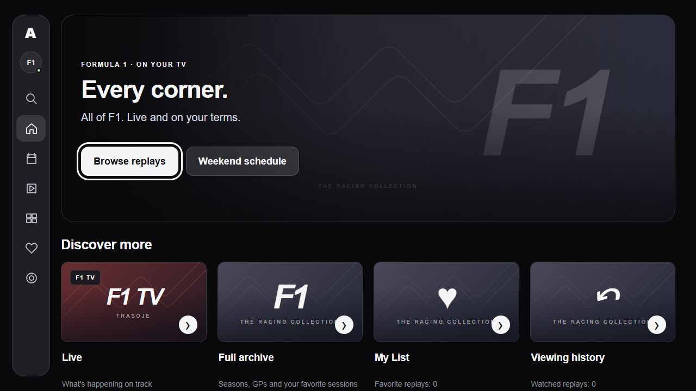
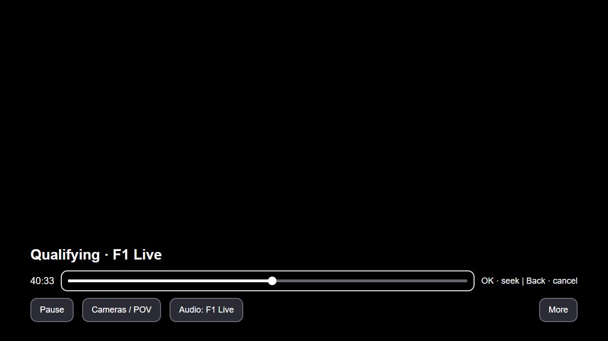
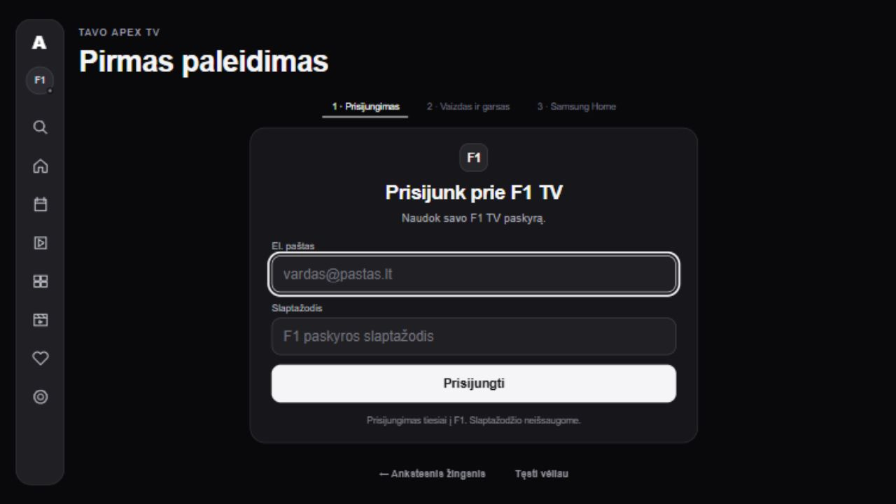
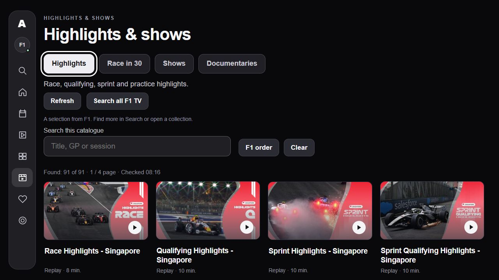

# Apex TV

An open-source F1 TV client for Samsung Tizen televisions.

Watch live sessions, replays and highlights with your TV remote. Apex TV runs
on the television and uses your own F1 TV account. A companion computer is
not required for playback.

[](https://github.com/Pajuodelis/apex-tv/actions/workflows/check.yml)
[](https://github.com/Pajuodelis/apex-tv/releases/latest)
[](LICENSE)

[Download](https://github.com/Pajuodelis/apex-tv/releases/latest)
· [Installation](INSTALL.md)
· [Diegimas lietuviškai](INSTALL-LT.md)
· [Changelog](CHANGELOG.md)
· [Report an issue](https://github.com/Pajuodelis/apex-tv/issues)

## What it does

- Live coverage, session replays, highlights, Race in 30 and F1 shows.
- Driver cameras, tracker and data views where provided by F1.
- F1 Live and International commentary, with available audio languages.
- Search, favorites, watch history and resume playback.
- Remote-controlled timeline seeking and native Samsung AVPlay playback.
- Upcoming-session schedule, English and Lithuanian menus, and signed updates.

Sign in by scanning the TV's QR code and approving the device on F1's official
website. If the page asks for a TV code, enter the code shown on the television.
See [sign-in help](docs/SIGN-IN.md) for alternatives and diagnostics.

Content, commentary and camera availability depend on F1, your subscription
and your region. F1 Live commentary is selected by default when available.

<a id="install--easiest-available-route"></a>

## Installation

Apex TV is installed through Developer Mode; it is not listed in Samsung's
app store.

1. Download [Apex-TV.wgt](https://github.com/Pajuodelis/apex-tv/releases/latest/download/Apex-TV.wgt).
2. Install the separate [Apps2Samsung installer](https://github.com/Apps2Samsung/Apps2Samsung/releases/latest)
   on an Android phone or a Windows, macOS or Linux computer.
3. Enable Developer Mode on the TV, connect the installer on the same network,
   and select the custom WGT option. The installer signs the package for your TV.
4. Open Apex TV and sign in using the QR code.

Follow the full guide for network, Developer Mode and certificate setup:
[English](INSTALL.md) · [Lietuviškai](INSTALL-LT.md).

The WGT is unsigned installer input. Copying it to a USB drive alone does not
install it. Once setup is complete, the phone or computer can be switched off.

## Compatibility

| Requirement | Details |
| --- | --- |
| TV platform | Samsung Tizen 6.0 or later |
| Account | An eligible F1 TV subscription for the content and region |
| Network | Internet access on the TV; a device on the same network for installation |
| Interface languages | English and Lithuanian |

**Tested hardware:** Samsung UE55AU7092, Tizen 6.0 (2021).

Qualifying, sprint, highlights, a live pre-race show and the main Singapore
Grand Prix broadcast have been verified with picture and sound. The TV
retrieved its own media and DRM licenses; replay playback was also checked
with the optional companion server stopped. Version 0.5.11 was tested on this
TV with retained sign-in, smooth menu navigation, picture and sound.

Tizen 6.0 is the package's minimum requirement, not a guarantee for every TV.
Physical Tizen 9 testing, additional models and regions, long-session stability
and DRM key rotation remain areas for further validation. The documented
Apps2Samsung route has not been independently verified end to end on another
user's television.

[Submit a compatibility report](https://github.com/Pajuodelis/apex-tv/issues/new?template=compatibility.yml)
with your model, Tizen version and playback results.

## Interface

The following screenshots show earlier interface versions using sample data.
They illustrate the app's layout and controls; they are not playback evidence.
The current release includes the interface changes described in the [changelog](CHANGELOG.md).

| Home | Player timeline |
| --- | --- |
|  |  |

| Sign-in | Highlights and shows |
| --- | --- |
|  |  |

## Remote controls

| Action | Control |
| --- | --- |
| Show player controls | OK |
| Pause or resume | Select Pause/Play, or use the remote's Play/Pause button |
| Preview another position | Focus the timeline and press Left/Right; hold to move faster |
| Confirm a seek | OK |
| Cancel a seek or hide controls | Back |
| Return to the menu | Back when controls are hidden |

Live seeking is limited to the DVR window provided by F1.

## Updates and account data

The TV downloads menu and player updates from the project's
[signed GitHub feed](updates/). Updates apply while playback is idle.
Before accepting an update, the app checks its RSA signature, file hashes,
version and rollback rules.

Startup-shell and permission changes require installing a new WGT with the
**same author certificate**. Keep a backup of your installer's certificates.
Changing the signing identity can require a fresh installation and loss of
saved app data.

Normal account, catalogue, media and license requests use F1's services;
update files come from GitHub. Account sessions are stored locally on the TV.
The public package has no configured companion monitoring endpoint.
Compatibility reports are generated locally and exclude account credentials.
See [Privacy](PRIVACY.md) for storage details, optional companion behavior and
access limitations.

## Development

The TV interface is written in JavaScript, HTML and CSS. The Tizen shell starts
the bundled or verified cached menu, and playback uses Samsung AVPlay. An
optional Electron companion is included for development and alternate sign-in.

Requires Node.js 22 or newer:

```sh
npm ci --ignore-scripts
npm run check:public
npm test
npm run build:tv
```

The build produces `dist/Apex-TV.wgt` and `dist/SHA256SUMS`. A Samsung SDK and
the publisher's private update key are not needed to build the unsigned WGT.

- [Development guide](docs/DEVELOPMENT.md): architecture, local setup and forks.
- [Contributing](CONTRIBUTING.md): bug reports, compatibility results and pull requests.
- [Downloads](DOWNLOADS.md): release files and checksum verification.

## License

Apex TV is an independent community project, not affiliated with or endorsed
by Formula 1 or Samsung. It requires your own eligible subscription and does
not bypass account, region, concurrent-screen or DRM restrictions.

Original code is released under the [MIT license](LICENSE). Dependencies
retain their own licenses; see [third-party notices](THIRD_PARTY_NOTICES.md).
