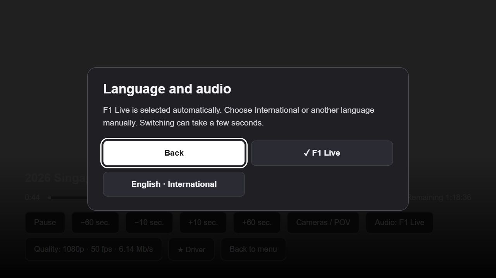
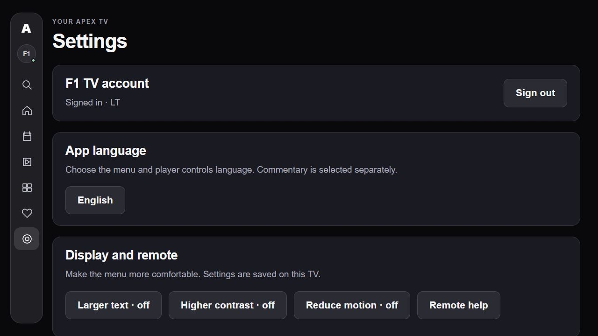
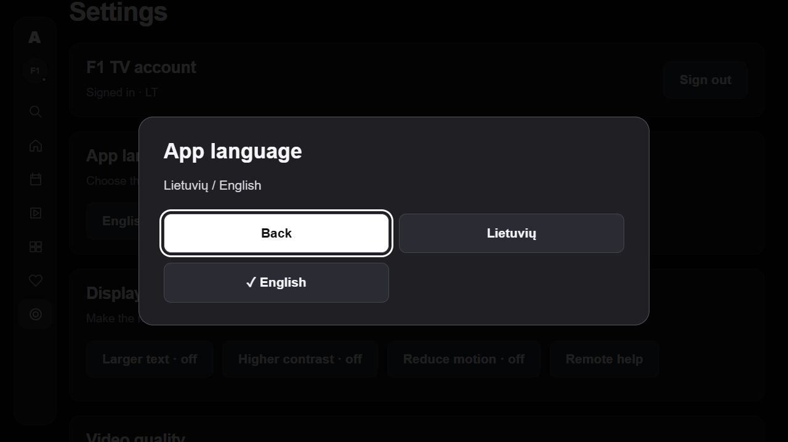
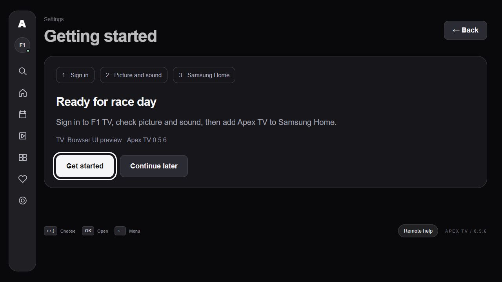
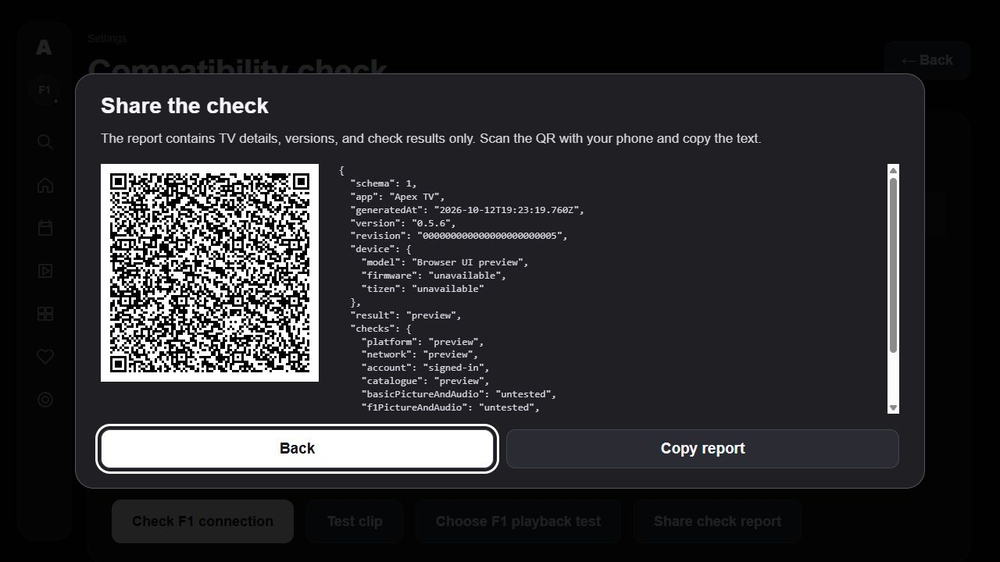

# Apex TV

**Watch F1 TV directly on your Samsung television.**

An independent, open-source F1 TV client for Samsung Tizen TVs. Sign in with
your own F1 TV account and watch live sessions and replays using your TV
remote. After installation, no phone or computer needs to stay running.

[](https://github.com/Pajuodelis/apex-tv/releases/latest)
[](https://github.com/Pajuodelis/apex-tv/actions/workflows/check.yml)
[](LICENSE)

**[Download the TV app](https://github.com/Pajuodelis/apex-tv/releases/latest/download/Apex-TV.wgt)**
· [Install in English](INSTALL.md)
· [Diegimas lietuviškai](INSTALL-LT.md)
· [All downloads](DOWNLOADS.md)

## Features

- Browse live sessions, the race weekend and the archive.
- Choose available driver cameras, the tracker and data views.
- Switch between F1 Live, International and available commentary languages.
- Search, save favorites and resume watching.
- Navigate with your TV remote and use native Samsung AVPlay playback.
- Choose English or Lithuanian menus independently of commentary language.
- Receive signed menu and player updates directly on the TV.
- Browse highlights, Race in 30, official F1 shows and documentaries.
- Sign in with a clean English or Lithuanian screen and readable inline errors.
- Sign in on your phone using an official F1 QR/code pairing flow, without a computer.
- Follow a first-run guide for sign-in, picture/sound checks and Add to Home.
- Run compatibility checks and share an allowlisted diagnostic report as a local QR code.
- Use four primary player actions and a remote timeline: Up, arrows to choose, OK to seek; holding an arrow accelerates.

F1 Live commentary is selected by default when available. Choose
International manually under **Audio**. Press **OK** to show controls, then **OK** on
**Pause** to pause. The remote's dedicated **Play/Pause** button works immediately.
Press **Back** to hide player controls;
press it again to return to the menu. Timeline changes remain a preview until
**OK**; **Back** cancels the selection and hides controls. Live seeking is
available only within the DVR window supplied by F1.

## Compatibility

| Requirement | Details |
| --- | --- |
| Television | Samsung TV running **Tizen 6.0 or later** |
| Account | Your own F1 TV subscription with access to the selected content in your region |
| Connection | Internet access on the TV |
| Initial installation | Android phone or Windows, macOS or Linux computer on the same network as the TV |
| Menu languages | English and Lithuanian; the public package starts in English |

**Verified device: Samsung UE55AU7092 · Tizen 6.0 · 2021.** Picture and sound
were confirmed for qualifying, sprint, a live pre-race studio feed and the
main 2026 Singapore Grand Prix broadcast. Main-race playback was confirmed
on **11 October 2026**. The TV fetched its own media and DRM licenses; archive
playback was also confirmed with the optional companion server stopped.

Other TV models, regions and subscription tiers still need testing. The
package's Tizen requirement is not a guarantee of playback on every model.
Long-session stability and license/key rotation require separate verification.
The Apps2Samsung installation route was reviewed against its v2.8.2 source
and the WGT build, but has not yet been tested end to end on another user's TV.

Tried a different model? [Share a compatibility report](https://github.com/Pajuodelis/apex-tv/issues/new?template=compatibility.yml).

<a id="install--easiest-available-route"></a>

## Installation

1. Download [Apex-TV.wgt](https://github.com/Pajuodelis/apex-tv/releases/latest/download/Apex-TV.wgt)
   and the separate [Apps2Samsung installer](https://github.com/Apps2Samsung/Apps2Samsung/releases/latest).
2. Enable **Developer Mode** on your TV and connect Apps2Samsung.
3. Select the custom WGT option and install **Apex-TV.wgt**. Apps2Samsung signs
   the package locally for your TV.
4. Open **Apex TV** and sign in with your own F1 TV account on the television.

Follow the full guide for the Developer Mode, network and certificate steps:
**[English](INSTALL.md)** · **[Lietuviškai](INSTALL-LT.md)**.

After installation, you can switch off the phone or computer. Copying the
WGT to a USB stick does not install it on a consumer Tizen TV.

## Screenshots

English **v0.5.5** interface previews using sample data. These images show the
interface, not live race footage or playback verification.

| Home | Audio selection |
| --- | --- |
|  |  |

| Settings | App language |
| --- | --- |
|  |  |

New **v0.5.6** previews, also using sample data:

| Getting started | Remote timeline |
| --- | --- |
|  |  |



## New in v0.5.7

Browser previews below use sample data. No real account details or race footage are included.

| Clean sign-in | Highlights and shows |
| --- | --- |
|  |  |

## Updates

### Sign-in rejected with HTTP 403?

Version 0.5.9 adds **Sign in with your phone**: scan the TV's QR and approve
on F1's official page. If asked for a **TV code**, enter the displayed code
on your phone. No computer or Apex account server is involved.

The app reports the exact failed sign-in step. Use **Show sign-in
diagnostics** on the TV; the report excludes account credentials and tokens.
An alternative uses the official F1 window in the optional desktop companion
and a private, encrypted TV session handoff. A computer is needed for that
pairing step or signing in again, but not for playback afterwards.
See [sign-in instructions](docs/SIGN-IN.md). This does not override an F1
account, subscription, region or anti-bot rejection. Tizen 9 still needs its
own physical test.

Menu and player updates arrive directly from the
[public update feed](https://github.com/Pajuodelis/apex-tv/tree/main/updates)
and apply when playback is idle. The TV checks their RSA signature, SHA-256
integrity, version and rollback rules before accepting them.

Native shell or permission changes require a new WGT installation using the
**same installer author certificate**. Back up your Apps2Samsung certificates
and settings; losing the certificate can require reinstalling the app and
clearing its saved login and preferences.

## Build and contribute

Requires **Node.js 22 or newer**.

```sh
npm ci --ignore-scripts
npm run check:public
npm test
npm run build:tv
```

The build creates `dist/Apex-TV.wgt` and `dist/SHA256SUMS`. No Samsung SDK or
publisher private key is needed to build this unsigned installer package.

- [Development guide](docs/DEVELOPMENT.md) — architecture, forks and optional companion.
- [Contributing](CONTRIBUTING.md) — pull requests and testing expectations.
- [Report a bug](https://github.com/Pajuodelis/apex-tv/issues/new?template=bug-report.yml) — include your model, versions and a sanitized error.
- [Changelog](CHANGELOG.md) — release history.
- [Privacy](PRIVACY.md) — account storage, service requests and diagnostics.

## License and affiliation

Original Apex TV code is available under the [MIT license](LICENSE).
Dependencies retain their own licenses; see [third-party notices](THIRD_PARTY_NOTICES.md).

Apex TV is not affiliated with or endorsed by Formula 1 or Samsung. It
requires an eligible F1 TV subscription and respects normal region, account,
concurrent-screen and DRM restrictions.
